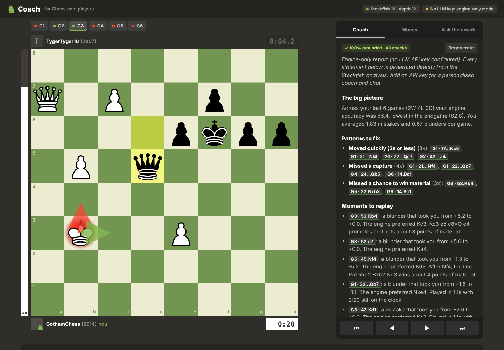
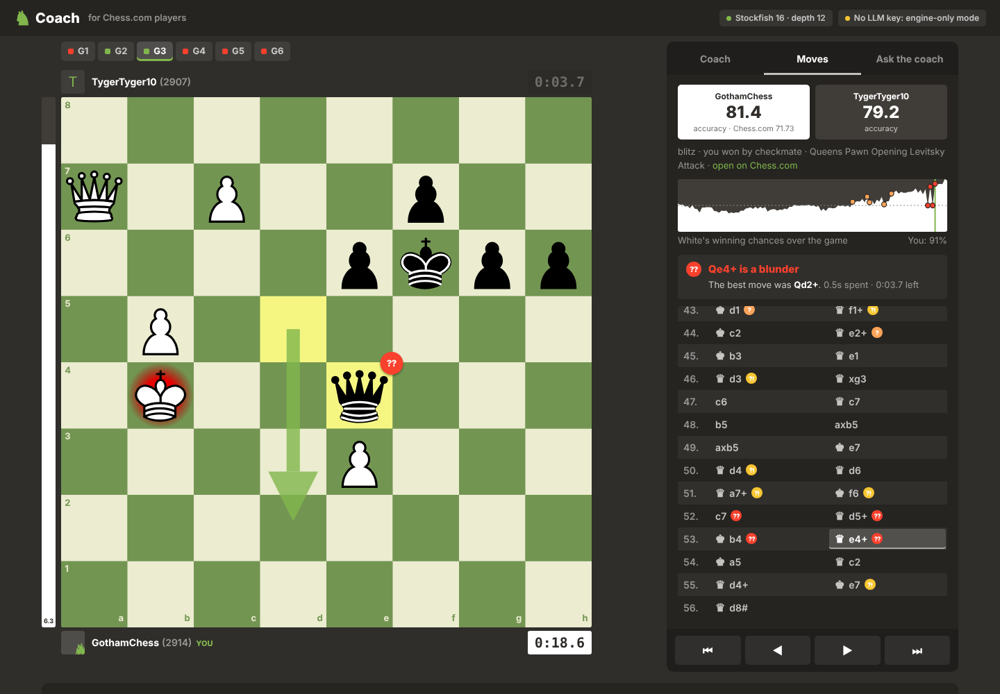
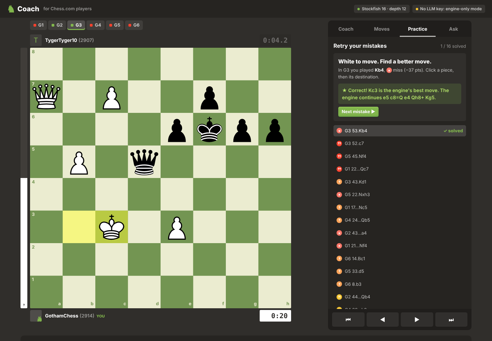
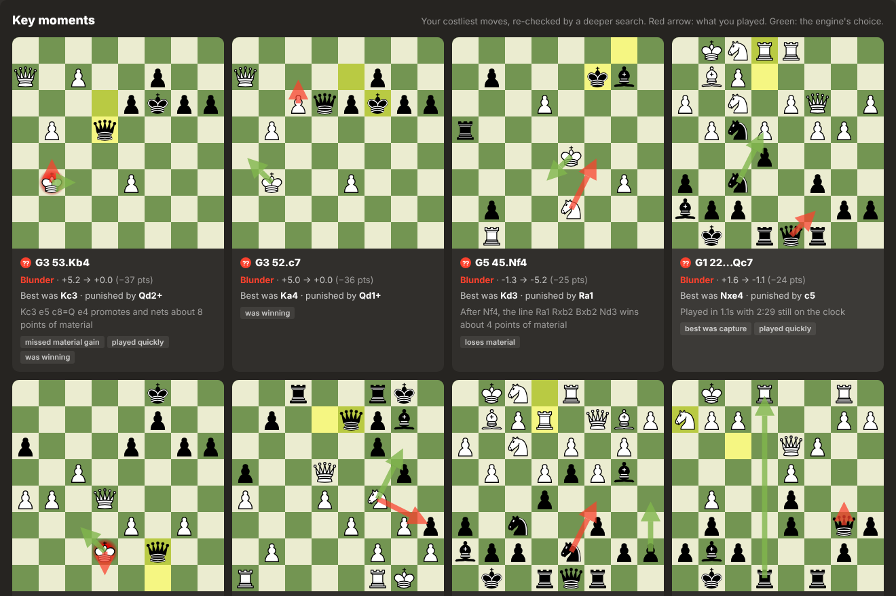
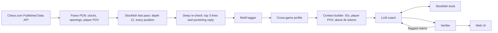

# Coach: an engine-grounded AI chess coach for Chess.com players

[](https://github.com/Manas2006/chesscom-ai-coach/actions/workflows/ci.yml) [](https://render.com/deploy?repo=https://github.com/Manas2006/chesscom-ai-coach)

Enter a Chess.com username. Stockfish analyses your recent games and finds the moves that cost you the most, an LLM explains the patterns behind them and builds a 7-day plan, and **every move, citation and evaluation the LLM writes is checked against the engine before you see it.**



The core idea: **Stockfish and plain code decide what is true. The LLM decides what matters and explains why.** LLMs are bad at reading chess positions, so the model never calculates anything: it receives engine-verified facts with stable IDs, can call Stockfish through tools when the player asks "what if?", and its output is mechanically verified, with one automatic repair pass when something does not check out.

## Quick start

**One command (only needs Docker):**

```bash
docker compose up --build
```

Open http://localhost:8000 and type any Chess.com username, or click **Browse a sample review** (real games bundled in `fixtures/`: the author's own last 10 games, plus 6 GothamChess blitz games used by the tests; works with no network).

**Add the AI coach (optional):** without a key the app runs in engine-only mode (full analysis plus a deterministic template report; chat disabled). For the LLM coach:

```bash
cp .env.example .env   # then set ANTHROPIC_API_KEY=... (or OPENAI_API_KEY=...)
docker compose up --build
```

**Hosted:** [chesscom-ai-coach.onrender.com](https://chesscom-ai-coach.onrender.com). It runs on Render's free tier, which puts the instance to sleep after a period of inactivity, so **the first load can take a minute or so** while it wakes up; after that it is quick. The Deploy to Render button builds the same image from `render.yaml`. Paste an API key in the Render dashboard; `LLM_RATE_LIMIT_PER_HOUR` (20 per visitor by default there) protects your budget on a public link.

**Sample review:** the landing page offers a pre-analysed review of a real account (fixture data under `fixtures/`, engine analysis done at build time, coach report frozen in `fixtures/<player>/report.json`), so there is something to look through while your own games are being analysed: a banner tells you when yours is ready. `DEMO_PLAYER` picks which fixture is shown; `python -m coach.snapshot <player>` refreshes the frozen report.

**Without Docker:** install Stockfish (`brew install stockfish` or `apt install stockfish`) and [uv](https://docs.astral.sh/uv/), then `make run`.

| Command | What it does |
|---|---|
| `make up` | `docker compose up --build` |
| `make run` | Run locally with uv |
| `make test` | 160 tests: parsing, engine, motif tags, verifier, agent loop, streaming and provider wire formats, practice mode, rate limit, HTTP API, plus edge cases (mate and stalemate games, daily games, malformed API data, sloppy tool arguments, bad requests) |
| `make eval` | Grounded vs ungrounded ablation (needs an API key), writes `evals/RESULTS.md` |
| `make eval-dry` | Exercise the eval harness without an API key |
| `python -m coach.snapshot <player>` | Freeze the coach report for a fixture player into `fixtures/<player>/report.json` (the instant sample review) |

## What it does

- **Finds your costliest moves.** Every position is evaluated at depth 12. Your worst candidates get a deeper multi-line re-check plus a search for the opponent's punishing reply. Fast-pass false positives are discarded, and verdicts are reproducible run to run.
- **Explains why, with evidence.** Deterministic pattern tags (hung a piece, allowed a fork, missed a capture, missed a mate, moved in under 2 seconds, low on the clock, slipped while winning) and cross-game aggregates (accuracy by phase, errors per game, openings, thrown wins).
- **Writes a coaching report** whose every claim cites a real move as `[[G1 22...Qc7]]`. Citations render as chips that jump the board to that position, with red and green arrows for the played and best moves.
- **Lets you ask follow-ups.** The chat coach can run Stockfish on demand (`evaluate_move`, `analyze_position`, `get_moment`, `get_game_moves`), and each tool call is shown in the answer. Every move in the review has an "Ask the coach about this move" button.
- **Streams.** Report and chat text appear as they are written, with live status lines for each Stockfish tool call, the verification pass and any repair.
- **Turns your mistakes into puzzles.** The Practice tab replays each key moment as "find a better move" on a clickable board. Stockfish grades every try (the best move, or anything within 5 points of it, counts), shows the punishing reply when you are wrong, and gives three levels of hints (theme, piece, solution).
- **Shows you how grounded it is.** A badge reports the share of checked claims that passed. Unsupported moves or evaluations are highlighted in the text.
- **Feels native to Chess.com.** The review screen follows Chess.com's Game Review conventions: eval bar, player bars with the clock at every move, a White-advantage graph, classification badges on the board (best, excellent, good, inaccuracy, mistake, miss, blunder; a "miss" is failing to punish the opponent's error), and a figurine move list with an explanation of the current move. Colors, board theme and radii come from Chess.com's public CSS design tokens. Pieces are python-chess's open-licensed set, and no Chess.com logos, fonts or icon art are bundled.







## How it works



Details, numbers and trade-offs are in **[docs/DESIGN.md](docs/DESIGN.md)**. The short version:

**System design.** FastAPI backend plus a dependency-free single-page UI styled with Chess.com's design tokens (boards are SVGs rendered server-side by python-chess, so there is no frontend build step and no CDN). Analysis runs as a background job across a pool of Stockfish processes and is cached on disk per game. Chess.com responses are cached too (past months forever, the current month for 5 minutes), requests are serial with a descriptive User-Agent, and 429s are retried with backoff. LLM providers (Anthropic or OpenAI) are thin raw-HTTP adapters behind one interface with a neutral message format.

**Context and prompting strategy.**
1. *Facts, not raw data.* The model never sees a bare PGN to "read". It gets engine verdicts, top lines, the opponent's best reply, clocks, verified pattern tags and pre-computed aggregates. It is told to treat these as exact and never recompute them.
2. *Stable, verifiable IDs.* Games are `G1..Gn` and moves are cited as `[[G1 22...Qc7]]`. Because the citation includes the move actually played, a wrong citation is detectable, and every citation doubles as a UI link.
3. *One point of view.* All evals and win chances are from the coached player's side, so the model never has to flip signs.
4. *Rules mapped to failure modes.* Each ground rule in `coach/prompts.py` targets a specific LLM failure on chess: invented moves, made-up evals, misread positions, self-computed statistics, generic advice.
5. *Level-aware pitch.* The player's rating band (beginner to master) selects how deep and how technical the explanations are.
6. *Tools instead of guessing.* Four narrow tools take move references (`G1 22...Qc7`) rather than FENs, since LLMs often corrupt FEN strings.
7. *Verify, then repair once.* After generation, the verifier checks citations, move legality in the positions the paragraph is about, whether recommended moves are engine top choices or were tool-checked, and whether quoted evals exist in the data. Flagged items go back to the model once with a targeted repair prompt.

## Evaluation

`evals/run_eval.py` runs the same report task on the same games under three conditions and scores all of them with the same verifier:

| Condition | What the model gets |
|---|---|
| Ungrounded | Only the PGN move lists (a naive "paste your games into a chatbot" coach) |
| Grounded, first draft | The engine context plus Stockfish tools |
| Grounded + verify/repair | What the app shows: the draft after one repair pass |

Metrics: citation validity, move legality, recommendation agreement with Stockfish, and evaluation support. Run `make eval` (offline demo games) or `python -m evals.run_eval --live <usernames> --games 8` to produce `evals/RESULTS.md`, with raw outputs in `evals/samples/`. These metrics measure faithfulness to the engine, not coaching quality (see DESIGN.md for what they miss).

## Limitations

- The verifier is lexical. It checks moves, citations and numbers, but it cannot check a prose claim like "your bishop was passive". Pattern tags reduce the room for such claims but do not remove it.
- Bare pawn moves without a move number (`e4`) are treated as squares and not verified. Moves written that way slip through.
- Pattern tags are shallow, one-reply heuristics (for example, fork detection only looks at the opponent's first reply). They miss pins, overloading and deeper combinations.
- Engine strength is tuned for speed (depth 12 plus about 0.6 s per critical moment). Sharp positions can be misjudged, and a tag can disagree with a deeper search.
- "Engine accuracy" uses Lichess's published formulas; Chess.com's CAPS model is proprietary. The UI shows both numbers so the difference is visible.
- Small samples: 10 games give anecdotes, not statistics. The report shows counts and never claims significance.
- Sessions live in memory (a restart clears them; the analysis cache survives). There are no accounts and no persistence of progress over time.
- Daily games get no clock analysis. Variants (Chess960 and others) are skipped.
- An LLM report still takes roughly 15 to 40 seconds end to end; streaming makes the wait visible but not shorter.
- The rate limit is in-memory and per process; a multi-instance deployment would need a shared store.

## What I would do next

1. **Spaced repetition for practice:** persist solved and failed puzzles, resurface the ones you missed, and track whether pattern counts fall over time.
2. **Start the report earlier:** generate it while the engine is still finishing later games.
3. **Opening repertoire diagnosis:** compare the player's first 12 moves against an opening book or master database to find exactly where they leave theory and how that correlates with results.
4. **Richer tactical motifs:** pins, skewers, overloaded defenders and back-rank weaknesses via static exchange evaluation and attack maps.
5. **Judge coaching quality, not just faithfulness:** a rubric-based LLM judge calibrated against a small set of human (titled-player) ratings, plus A/B prompt experiments.
6. **The rest of Game Review's vocabulary:** Book (needs an opening database), Great (only move) and Brilliant (a sound sacrifice), each a deterministic rule on top of the existing engine data.
7. **Rating-aware thresholds:** Chess.com's Game Review classifies moves relative to the player's level. Adopting that would make "mistake" mean the same thing to a 900 and a 2400.
8. **Persistence:** store sessions and reports so a player can come back, and show progress week to week.

## Project layout

```
coach/
  chesscom.py   Chess.com API client (cache, backoff) + offline fixture client
  pgn.py        Chess.com game JSON -> player-centric plies with clocks and openings
  engine.py     Stockfish pool, win% model, move classification, deep re-check
  motifs.py     deterministic pattern tags for critical moments
  profile.py    cross-game aggregates the LLM is told to trust
  session.py    session model and move-reference resolution
  context.py    the context the LLM sees (and the PGN-only ablation)
  prompts.py    system prompts, ground rules, report structure, repair prompt
  llm.py        Anthropic / OpenAI raw-HTTP adapters + scripted provider for tests
  agent.py      tool-using agent loop, report and chat, engine-only fallback
  verify.py     post-hoc grounding checker
  practice.py   "retry your mistakes" puzzles graded by Stockfish
  warm.py       pre-analyses the demo games at docker build time
  service.py    jobs, caching, orchestration, board rendering
  server.py     FastAPI routes; static/ holds the UI
fixtures/       real games + profiles from the Chess.com API (sample review, tests), one directory per player
evals/          grounded vs ungrounded ablation
tests/          pytest suite (Stockfish required)
docs/           DESIGN.md, AI_USAGE.md, screenshots
```

## Time spent and AI usage

See [docs/AI_USAGE.md](docs/AI_USAGE.md) for the time breakdown and agent transcripts.
